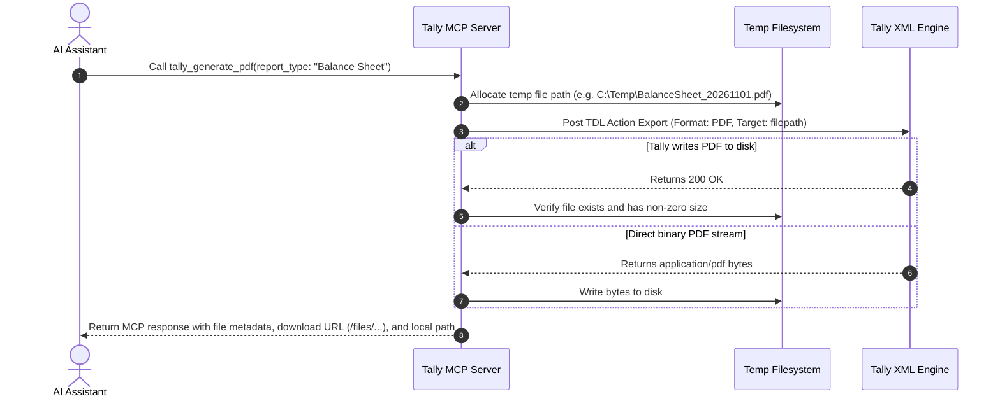
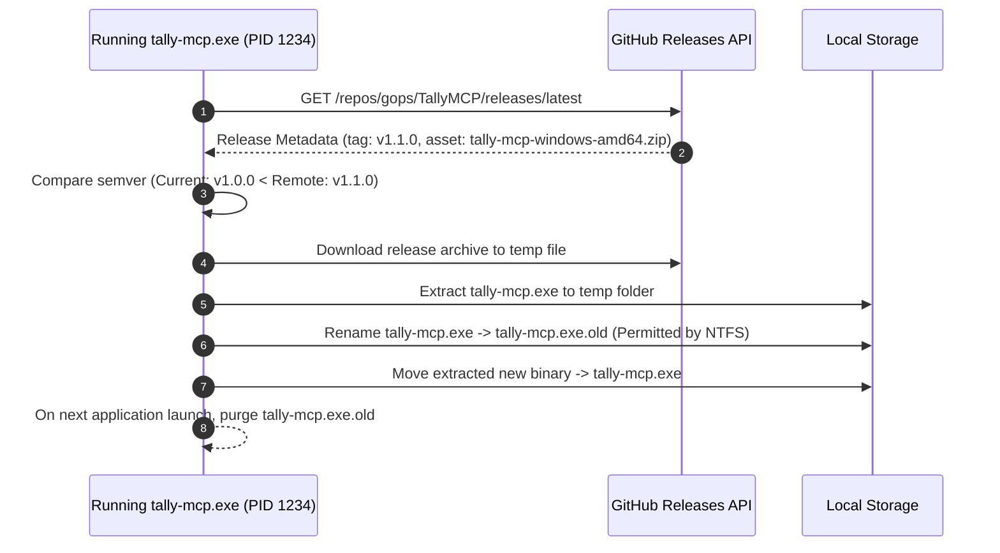

# Tally MCP Server Architecture & Technical Reference

This document provides a comprehensive technical overview of the **Tally MCP Server** architecture, internal subsystems, concurrency control, communication protocols, and design decisions.

For installation, usage, and AI client configuration instructions, see the user-facing [README.md](./README.md).

---

## 1. System Overview

Tally MCP serves as a high-performance, asynchronous bridge between modern AI assistants (such as Claude Desktop, Cursor, Windsurf, or custom agent frameworks) and **Tally ERP 9 / TallyPrime** instances running on a Windows host.

The bridge communicates with AI clients over the standard **Model Context Protocol (MCP)** using modern Streamable HTTP and legacy Server-Sent Events (SSE), and interfaces with Tally's local XML server via HTTP over a strict serialized pipeline.

```
┌─────────────────────────────────────────────────────────────────────────────────────────┐
│                                     AI Client Layer                                     │
│            Claude Desktop  │  Cursor  │  Windsurf  │  Custom Agents / Frameworks        │
└────────────────────────────────────────────┬────────────────────────────────────────────┘
                                             │ MCP Protocol (Streamable HTTP / SSE)
                                             ▼
┌─────────────────────────────────────────────────────────────────────────────────────────┐
│                                   Tally MCP Server                                      │
│                                                                                         │
│  ┌───────────────────────────────────────────────────────────────────────────────────┐  │
│  │ Inbound Transport & Middleware Layer                                              │  │
│  │ - Port Listener & Conflict Discovery (internal/mcp/listener.go)                   │  │
│  │ - Streamable HTTP (/mcp) & Legacy SSE (/sse) Handlers (internal/mcp/server.go)    │  │
│  │ - Bearer Token / API Key Auth & CORS Middleware (internal/auth/auth.go)           │  │
│  │ - File Server (/files/) & Health Endpoint (/health)                               │  │
│  └─────────────────────────────────────────┬─────────────────────────────────────────┘  │
│                                            │                                            │
│  ┌─────────────────────────────────────────▼─────────────────────────────────────────┐  │
│  │ MCP Tool Handlers & Token Optimization (internal/mcp/handlers.go)                 │  │
│  │ - Master data caching / cache invalidation                                        │  │
│  │ - Server-side substring filtering & LLM pagination                                │  │
│  │ - Compact schema projection & whitespace stripping                                │  │
│  └─────────────────────────────────────────┬─────────────────────────────────────────┘  │
│                                            │                                            │
│  ┌─────────────────────────────────────────▼─────────────────────────────────────────┐  │
│  │ Tally Core Engine (internal/tally)                                                │  │
│  │ ┌──────────────────────────────────────────────────────────────────────────────┐  │  │
│  │ │ Concurrency Control: Zero-Overload Serializer & Queue Buffer                 │  │  │
│  │ │ - querySem (cap 1)     - queueSem (cap 100)     - throttleMs (cooldown)      │  │  │
│  │ └───────────────────────────────────────┬──────────────────────────────────────┘  │  │
│  │ ┌───────────────────────────────────────▼──────────────────────────────────────┐  │  │
│  │ │ In-Memory TTL Cache (internal/tally/cache.go)                                │  │  │
│  │ └───────────────────────────────────────┬──────────────────────────────────────┘  │  │
│  │ ┌───────────────────────────────────────▼──────────────────────────────────────┐  │  │
│  │ │ XML / TDL Envelope Builder (queries.go, xml_utils.go)                        │  │  │
│  │ └───────────────────────────────────────┬──────────────────────────────────────┘  │  │
│  │ ┌───────────────────────────────────────▼──────────────────────────────────────┐  │  │
│  │ │ PDF Generation & Temp Delivery (pdf.go)                                      │  │  │
│  │ └──────────────────────────────────────────────────────────────────────────────┘  │  │
│  └─────────────────────────────────────────┬─────────────────────────────────────────┘  │
│                                            │                                            │
│  ┌─────────────────────────────────────────┴─────────────────────────────────────────┐  │
│  │ Windows Platform Services (internal/tray, internal/updater)                       │  │
│  │ - Win32 System Tray & Message Loop     - Netsh Firewall Management (Elevated UAC) │  │
│  │ - Registry Autostart (HKCU\...\Run)    - In-place Locked Binary Updater (.old)    │  │
│  └───────────────────────────────────────────────────────────────────────────────────┘  │
└────────────────────────────────────────────┬────────────────────────────────────────────┘
                                             │ HTTP XML / TDL (Port 9000)
                                             ▼
┌─────────────────────────────────────────────────────────────────────────────────────────┐
│                               Tally ERP 9 / TallyPrime                                  │
│                               Single-Threaded XML Server                                │
└─────────────────────────────────────────────────────────────────────────────────────────┘
```

---

## 2. Component Architecture

### 2.1 Inbound Transport & Middleware (`internal/mcp`, `internal/auth`)

1. **Dual Transport MCP Architecture**:
   - **Streamable HTTP (`/mcp`)**: Implements the modern Model Context Protocol specification (2025-03-26). AI clients make POST requests directly to `/mcp` with standard JSON-RPC payloads. Supports streaming responses, session headers, and keep-alive connections.
   - **Legacy Server-Sent Events (`/sse`)**: Provides backwards compatibility for clients like Claude Desktop that connect via SSE streams and submit tool calls via separate POST messages.
2. **Dynamic Port Discovery & Conflict Resolution (`internal/mcp/listener.go`)**:
   - When configured with a port (default: `8080`), the server attempts to bind the address.
   - If the port is already occupied (e.g. by another running instance, a web server, or dev tools), `BindAvailableListener` automatically tests successive ports (`8081`, `8082`, etc.) within an allowed search window.
   - The active bound port is stored thread-safely in `Server.activePort` and surfaced to the UI tray icon, menu labels, and dashboard links.
3. **Authentication & CORS Middleware (`internal/auth/auth.go`)**:
   - When `auth.enabled: true` in `config.yaml`, the middleware intercepts incoming requests to `/mcp`, `/sse`, and `/files/`.
   - Accepts authentication through either:
     - `Authorization: Bearer <key>` header.
     - `X-API-Key: <key>` header.
     - `?token=<key>` query parameter (essential for SSE connections where headers cannot be customized by some clients).
   - Enforces preflight `OPTIONS` handling with full `Access-Control-Allow-*` headers for browser-based AI frontends.
4. **File Delivery Service (`/files/`)**:
   - Serves generated PDF invoices and statements from the operating system's temporary directory.
   - Restricts file access to authorized clients and uses sanitized file path validation to prevent path traversal attacks.

---

### 2.2 Concurrency Control & Query Serialization (`internal/tally/client.go`)

#### The Problem: Tally's Single-Threaded XML Server
Tally's built-in HTTP server operates on a single-threaded message loop. When parallel HTTP requests are dispatched simultaneously:
- Tally may drop sockets abruptly (`ECONNRESET`).
- Tally's UI can freeze or lock shared company data files.
- Response payloads can get corrupted or yield incomplete XML fragments.

#### The Solution: Zero-Overload Serializer Pipeline
The `Client` struct manages request dispatch through a dual-channel synchronization construct:

```go
type Client struct {
    baseURL          string
    httpClient       *http.Client
    defaultCompany   string
    querySem         chan struct{} // Capacity: 1 (guarantees strictly zero parallel execution)
    queueSem         chan struct{} // Capacity: MaxQueueSize (buffers requests under peak load)
    throttleDuration time.Duration // Mandatory sleep between consecutive queries
    cache            *MemoryCache  // Thread-safe TTL cache for master data
}
```

```
Incoming Tool Calls (Parallel)
      │      │      │      │
      ▼      ▼      ▼      ▼
┌─────────────────────────────────────────────────────────────┐
│ queueSem (Buffered Channel, Capacity: MaxQueueSize = 100)   │
│ - Immediate error if queue buffer is saturated              │
└──────────────────────────────┬──────────────────────────────┘
                               │
                               ▼
┌─────────────────────────────────────────────────────────────┐
│ querySem (Mutex Channel, Capacity: 1)                       │
│ - Strictly 1 query active at any instant                    │
└──────────────────────────────┬──────────────────────────────┘
                               │
                               ▼
┌─────────────────────────────────────────────────────────────┐
│ Execute HTTP POST to Tally XML Endpoint (Port 9000)          │
└──────────────────────────────┬──────────────────────────────┘
                               │
                               ▼
┌─────────────────────────────────────────────────────────────┐
│ Post-Query Throttle: Sleep throttleDuration (default: 15ms) │
│ - Relinquishes querySem only after cooldown completes       │
└─────────────────────────────────────────────────────────────┘
```

1. **Queue Buffer (`queueSem`)**: Incoming queries acquire a slot in `queueSem`. If the queue reaches capacity (configured via `max_queue_size`, default 100), new queries are immediately rejected with a descriptive error instead of accumulating indefinitely in socket buffers.
2. **Strict Serializer (`querySem`)**: Only one goroutine can hold `querySem` at a time. All other buffered requests block cleanly until the active query completes.
3. **Throttling Cooldown (`throttleDuration`)**: After Tally completes a query and closes its response body, the executing goroutine sleeps for `throttle_ms` (default 15ms) *before* releasing `querySem`. This prevents socket exhaustion and gives Tally's runtime time to reset its internal XML parser state.
4. **Queue Health Metrics**: Current queue depth and maximum capacity are tracked via `QueueStats()` and reported through `tally_status` and `/health`.

---

### 2.3 Agentic Performance & Token Optimization

LLM context windows and processing latency are critical bottlenecks when interacting with enterprise accounting databases. A raw dump of 10,000 ledgers or inventory items from Tally can exceed 2 million tokens and take 30+ seconds to transfer.

Tally MCP employs a multi-tiered token optimization strategy:

| Optimization Tier | Mechanism | Impact |
|---|---|---|
| **In-Memory TTL Cache** | `internal/tally/cache.go` caches master collections (`companies`, `ledgers`, `stock items`) with thread-safe `sync.RWMutex` and configurable TTL (default: 30s). | Responses return in $< 1\text{ ms}$ on cache hits without triggering any Tally XML processing. |
| **Automatic Cache Invalidation** | Mutation operations (e.g. `tally_create_ledger`) call `InvalidateCache("ledgers")` immediately after successful commit. | Guarantees read consistency without manual cache flushing. |
| **Server-Side Substring Filtering** | Filters ledgers and stock items in Go memory using case-insensitive substring matching on name, group, and state *before* JSON serialization. | Drops token payload by over 95% for targeted lookups. |
| **Strict LLM Pagination** | `limit` (default: 50, max: 250) and `offset` parameters with `has_more` and `next_offset` indicators. | Protects AI context windows from unbounded response explosions. |
| **Compact Mode (`summary_only`)** | Projections strip auxiliary metadata (currency, addresses, tax IDs, opening balances) when full profiles are not requested. | Reduces per-row token cost from ~120 tokens to ~25 tokens. |
| **Executive Summary Tool** | `tally_get_financial_summary` aggregates Cash/Bank, Receivables, Payables, Working Capital, Top Debtors/Creditors, and Revenue in a single call. | Delivers a complete company health snapshot in $< 350$ tokens. |
| **Whitespace-Free JSON** | Strips pretty-printing indentation from JSON payloads delivered to MCP clients. | Saves 20–30% raw token count across all responses. |

---

### 2.4 PDF Export Pipeline (`internal/tally/pdf.go`)

Tally MCP provides an automated pipeline allowing AI agents to generate official PDF reports and voucher printouts directly from Tally:



- **TDL Parameter Mapping**: Configures `SVEXPORTFORMAT: $$SysName:PDF` and `SVPRINTFILENAME` to instruct Tally's native print engine to output directly to disk.
- **Dual Export Mode**: Supports both Tally installations that save directly to disk and those that stream raw PDF bytes in HTTP response bodies.
- **Direct Agent Delivery**: The generated PDF URL is registered on the `/files/` endpoint, allowing users or remote agents to download the document immediately.

---

### 2.5 Native Windows OS Integration (`internal/tray`)

Tally MCP is compiled with Go's `-H=windowsgui` linker flag, suppressing the standard `cmd.exe` console window and running natively in the Windows Notification Area.

```
┌─────────────────────────────────────────────────────────────┐
│                    Windows Notification Area                │
│                                                             │
│                    [Tally MCP Tray Icon]                    │
│                              │                              │
│                              ▼ (Right-Click Context Menu)   │
│  ┌───────────────────────────────────────────────────────┐  │
│  │ 🟢 Tally MCP: Online (Port 8080)                      │  │
│  │ 🌐 Open Web Dashboard                                 │  │
│  │ ⚙️ Open config.yaml                                   │  │
│  │ ───────────────────────────────────────────────────── │  │
│  │ ✔ 🛡️ Allow through Windows Firewall                   │  │
│  │ ✔ 🚀 Start with Windows                               │  │
│  │ ───────────────────────────────────────────────────── │  │
│  │ 🔄 Check for Updates                                  │  │
│  │ 🚪 Exit                                               │  │
│  └───────────────────────────────────────────────────────┘  │
└─────────────────────────────────────────────────────────────┘
```

#### 1. System Tray Loop (`internal/tray/tray_windows.go`)
- Built on Win32 Shell API notifications (`Shell_NotifyIconW`).
- Embeds a high-resolution `.ico` icon and Windows manifest via `rsrc_windows_amd64.syso`.
- Runs a concurrent message pump listening for user menu selections and updating labels dynamically (e.g. displaying the bound port number).

#### 2. Firewall Automation (`internal/tray/firewall_windows.go`)
- Inspects and modifies Windows Defender Firewall rules using `netsh advfirewall firewall`.
- Rule definition:
  ```cmd
  netsh advfirewall firewall add rule name="TallyMCP Server (Port Range 8080-8090)" dir=in action=allow protocol=TCP localport=8080-8090 profile=any
  ```
- **UAC Self-Elevation**: If running as a standard non-elevated user, selecting the firewall toggle launches an elevated PowerShell process (`Start-Process -Verb RunAs`) to execute the rule creation, prompting the user with a standard Windows UAC confirmation dialog.

#### 3. Autostart Management (`internal/tray/autostart_windows.go`)
- Manages automatic launch on Windows boot using the user-level Registry key:
  `HKEY_CURRENT_USER\Software\Microsoft\Windows\CurrentVersion\Run`
- Requires zero administrative elevation, ensuring seamless setup on restricted enterprise workstations.

---

### 2.6 Safe Windows Self-Updater (`internal/updater`)

Windows NTFS enforces a file lock on executing binaries, preventing direct overwrite of running `.exe` files. Tally MCP circumvents this using an atomic file swap pattern:



1. **Semantic Version Negotiation**: Parses SemVer strings, ignoring `v` prefixes, and handles pre-releases cleanly.
2. **Asset Matching**: Inspects release zip contents for target architecture (`amd64` or `arm64`).
3. **Execution Safety**: The running binary can be triggered manually via CLI (`--update`), via System Tray (`Check for Updates`), or via MCP tool (`system_apply_update`).

---

## 3. Communication Protocols & Data Envelopes

### 3.1 Tally XML Request Envelope Format
All communication with Tally's XML engine uses HTTP `POST` requests sending structured XML envelopes.

#### Example: Master Ledger Collection Query
```xml
<ENVELOPE>
  <HEADER>
    <VERSION>1</VERSION>
    <TALLYREQUEST>Export</TALLYREQUEST>
    <TYPE>Data</TYPE>
    <ID>Ledger</ID>
  </HEADER>
  <BODY>
    <DESC>
      <STATICVARIABLES>
        <SVEXPORTFORMAT>$$SysName:XML</SVEXPORTFORMAT>
        <SVCURRENTCOMPANY>Demo Company</SVCURRENTCOMPANY>
      </STATICVARIABLES>
    </DESC>
  </BODY>
</ENVELOPE>
```

#### Example: Native TDL Report Export Query
```xml
<ENVELOPE>
  <HEADER>
    <VERSION>1</VERSION>
    <TALLYREQUEST>Export</TALLYREQUEST>
    <TYPE>Data</TYPE>
    <ID>Profit and Loss</ID>
  </HEADER>
  <BODY>
    <DESC>
      <STATICVARIABLES>
        <SVEXPORTFORMAT>$$SysName:XML</SVEXPORTFORMAT>
        <SVFROMDATE>20250401</SVFROMDATE>
        <SVTODATE>20260331</SVTODATE>
      </STATICVARIABLES>
    </DESC>
  </BODY>
</ENVELOPE>
```

#### Example: Ledger Creation Import Envelope
```xml
<ENVELOPE>
  <HEADER>
    <VERSION>1</VERSION>
    <TALLYREQUEST>Import</TALLYREQUEST>
    <TYPE>Data</TYPE>
    <ID>All Masters</ID>
  </HEADER>
  <BODY>
    <DESC>
      <STATICVARIABLES>
        <SVCURRENTCOMPANY>Demo Company</SVCURRENTCOMPANY>
      </STATICVARIABLES>
    </DESC>
    <DATA>
      <TALLYMESSAGE xmlns:UDF="TallyUDF">
        <LEDGER NAME="ACME Suppliers" ACTION="Create">
          <NAME>ACME Suppliers</NAME>
          <PARENT>Sundry Creditors</PARENT>
          <OPENINGBALANCE>-50000.00</OPENINGBALANCE>
        </LEDGER>
      </TALLYMESSAGE>
    </DATA>
  </BODY>
</ENVELOPE>
```

---

### 3.2 Tally XML Response Parsing (`internal/tally/xml_utils.go`)

Tally does not output standardized XML namespaces; instead, it uses heavily nested, case-sensitive XML nodes with optional User Defined Fields (`UDF`).

- **Dynamic Tag Unmarshaling**: `xml_utils.go` parses Tally's `<TALLYMESSAGE>` trees and normalizes amount formatting.
- **Tally Debit/Credit Sign Convention**: In Tally XML, debit balances are typically positive and credit balances are negative. The parser normalizes these values into standard accounting representations for LLM clarity.
- **Error Detection**: Tally reports errors in XML via `<LINEERROR>` tags inside `<RESPONSE>` or `<STATUS>`. The client detects these nodes and transforms them into standard Go error types.

---

## 4. MCP Tools Registry & Handlers

The MCP server registers the following tools in `internal/mcp/server.go`:

| Tool | Implementation | Primary Purpose |
|---|---|---|
| `tally_status` | `HandleTallyStatus` | Verifies Tally HTTP engine health, open company name, and queue statistics. |
| `tally_list_companies` | `HandleListCompanies` | Returns loaded companies (served from TTL cache). |
| `tally_get_financial_summary` | `HandleGetFinancialSummary` | High-level KPI snapshot (Cash, Receivables, Payables, Revenue, Net Profit). |
| `tally_list_ledgers` | `HandleListLedgers` | Searchable, paginated ledger list with compact mode option. |
| `tally_get_ledger` | `HandleGetLedger` | Full ledger contact, credit, and balance details. |
| `tally_list_vouchers` | `HandleListVouchers` | Date-filtered voucher header listings with pagination. |
| `tally_get_voucher` | `HandleGetVoucher` | Deep drilldown: ledger legs, inventory quantities, bill allocations, taxes. |
| `tally_get_stock_summary` | `HandleGetStockSummary` | Paginated stock inventory levels, rates, and valuations. |
| `tally_get_trial_balance` | `HandleGetTrialBalance` | Real-time debit and credit trial balance. |
| `tally_get_profit_and_loss` | `HandleGetProfitAndLoss` | P&L statement (Gross Profit, Expenses, Net Profit). |
| `tally_get_balance_sheet` | `HandleGetBalanceSheet` | Balance Sheet (Liabilities vs Assets, Capital, Loans). |
| `tally_get_outstanding_receivables` | `HandleGetOutstandingReceivables` | Bills receivable aging schedule. |
| `tally_get_outstanding_payables` | `HandleGetOutstandingPayables` | Bills payable aging schedule. |
| `tally_get_daybook` | `HandleGetDaybook` | Daily transaction journal. |
| `tally_generate_pdf` | `HandleGeneratePDF` | PDF report and invoice generation. |
| `tally_execute_xml` | `HandleExecuteXML` | Raw TDL / XML query execution escape hatch. |
| `tally_create_ledger` | `HandleCreateLedger` | Master ledger creation (auto-invalidates cache). |
| `system_check_update` | `HandleCheckUpdate` | Query GitHub for new releases. |
| `system_apply_update` | `HandleApplyUpdate` | Trigger in-place binary self-update. |

---

## 5. Security Model

1. **Local Network Boundary**:
   - By default, Tally listens strictly on `localhost:9000`. Tally MCP bridges this to `0.0.0.0:8080`, exposing the MCP interface to the local LAN.
2. **Authentication Middleware**:
   - When `auth.enabled` is `true`, all endpoints require a shared secret key via `Bearer <token>`, `X-API-Key`, or `?token=`.
3. **Write Protection & Mutation Boundaries**:
   - The majority of tools are read-only.
   - Mutating tools (`tally_create_ledger` and `tally_execute_xml`) are clearly documented and isolated so AI agent permission systems can enforce user approval before execution.
4. **Path Sanitization**:
   - PDF file delivery in `/files/` uses `filepath.Clean` and checks that target files reside strictly within the system's temporary directory.

---

## 6. Build, Testing & CI/CD Pipeline

### 6.1 Prerequisites
- [Go 1.24+](https://go.dev/)
- GNU Make (optional)
- For compiling Windows resource files (`.syso`): `github.com/akavel/rsrc`

### 6.2 Compilation & Linker Flags
To build a clean Windows binary without an intrusive console window:
```bash
GOOS=windows GOARCH=amd64 go build -mod=vendor \
  -ldflags "-s -w -H=windowsgui -X main.Version=v1.0.0 -X main.Commit=abcdef1 -X main.BuildDate=2026-11-01T12:00:00Z" \
  -o bin/tally-mcp.exe ./cmd/tally-mcp
```
- `-s -w`: Strips symbol table and debug information, reducing executable size.
- `-H=windowsgui`: Sets Windows GUI subsystem flag to suppress console window creation.
- `-X main.Version=...`: Injects build-time version metadata for runtime telemetry and update checks.

### 6.3 Test Suites
Unit and integration tests run without requiring a live Tally installation by using mock HTTP responders:
```bash
go test -v ./...
```
- `internal/auth`: Validates header, query token, and CORS preflight scenarios.
- `internal/config`: Verifies YAML loading and environment variable overrides.
- `internal/mcp`: Validates Streamable HTTP endpoints, port conflict fallback, and JSON-RPC tool dispatches.
- `internal/tally`: Tests XML builders, query serialization, buffer limits, cache invalidation, and PDF generation mocks.
- `internal/updater`: Tests semantic version comparison, asset selection, and archive extraction.

### 6.4 GitHub Actions CI/CD Pipeline (`.github/workflows/release.yml`)
When a Git tag matching `v*` is pushed:
1. Triggers automated matrix compilation for `windows/amd64` and `windows/arm64`.
2. Packages standalone `.zip` bundles containing `tally-mcp.exe`, `config.example.yaml`, `README.md`, and `LICENSE`.
3. Calculates SHA-256 checksums (`checksums.txt`).
4. Publishes an official GitHub Release with attached binaries and release notes.
